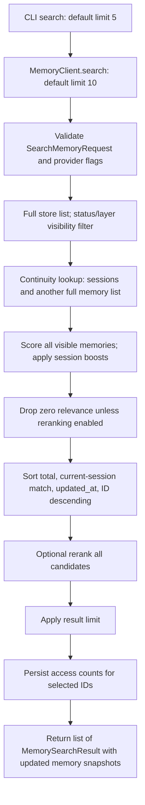

# Phase A architecture audit

## Audit basis

Repository-only audit of commit `19aab28f295a811039a75cf72c9e44920a5a142b`, followed by the stabilization changes described below. Initial `git status --short` was empty. No existing user modifications were present. Read root `AGENTS.md`, `CONTRIBUTING.md`, documentation instructions, packaging, workflows, implementation modules, and the relevant test suites. These reports are engineering Markdown deliverables, not new Mintlify navigation pages. No other repository, dataset, provider endpoint, or benchmark service was accessed.

Implementation evidence takes precedence over historical descriptions. Findings distinguish confirmed behavior from untested failure hypotheses. See [technical debt](TECHNICAL_DEBT.md), [correctness](RETRIEVAL_CORRECTNESS.md), and [validation summary](PHASE_A_SUMMARY.md).

## Package and delivery architecture

| Area | Actual source and symbols | Verified behavior |
| --- | --- | --- |
| Packaging | `pyproject.toml` | Hatchling build; version 0.4.1; Python >=3.11; wheel includes `mneno`, typing marker, and integration templates |
| Runtime dependencies | `pyproject.toml` | Pydantic >=2,<3, Rich >=13.7,<15, Typer >=0.12,<1, typing-extensions >=4.9; no provider SDK dependency |
| Development dependencies | `pyproject.toml` | build, mypy, pre-commit, pytest, pytest-asyncio, Ruff; only `dev` extra currently exists |
| Public SDK | `mneno/__init__.py`, `mneno/client.py:MemoryClient` | Synchronous client plus exported models, lifecycle/context/session/evaluation/trace helpers; root export surface is larger than the instruction's desired small surface |
| Interfaces | `storage/base.py:MemoryStore`, `scoring/base.py:MemoryScorer`, `retrieval/base.py:MemoryRetriever`, `compaction/base.py:MemoryCompactor` | Protocols; client orchestrates concrete default scorer/context/compactor rather than a generic retriever |
| CI | `.github/workflows/ci.yml` | Python 3.11/3.12/3.13; Ruff lint/format, strict mypy, pytest; universal wheel and Twine check |
| Release | `.github/workflows/release.yml` | Checks, sdist/wheel, tag/package-version validation, trusted PyPI publishing |
| Local tooling | `scripts/setup_dev.sh`, `check.sh`, `test.sh`, `format.sh` | uv or pip setup; check runs Ruff, format, mypy, pytest in order |
| Version reporting | `cli/version.py:get_version` | Distribution metadata rather than a separate SDK version constant |

All Python implementation packages are accounted for: `cli`, `compaction`, `conflicts`, `context`, `evaluation`, `extraction`, `hierarchy`, `io`, `observability`, `policies`, `providers`, `retrieval`, `scoring`, `sessions`, `storage`, plus `models.py` and `client.py`. `policies/config.py` re-exports `MemoryPolicy`; provider/base and package initializers mostly expose interfaces. `examples/` contains runnable SDK examples; `scripts/demo_cli.sh` exercises a temporary local workspace. No FTS, vector cache, graph engine, asynchronous retrieval runtime, or external telemetry is implemented.

## Memory and lifecycle architecture

`models.py:Memory` is a Pydantic v2 model with forbidden extra fields. UUID4 IDs are assigned on construction unless supplied. Content must have length >=1 (SDK whitespace-only content is still accepted). Importance is bounded [0,1], access count nonnegative, tags normalized with order-preserving deduplication. Fields include arbitrary metadata, source, created/updated/access timestamps, status, supersession/conflict links, audit events, layer/retention/promotion/demotion metadata, primary session ID, and sequence index. `Memory.infer_default_layer` supports old payloads without layers; missing status/links/audit use safe defaults. Missing persisted IDs currently get a new UUID: malformed legacy records cannot be assumed to have stable identity.

`client.py:add` delegates to `add_with_report`, validates `AddMemoryRequest`, constructs the memory, checks explicit session attachment, compares active existing records, resolves reports, writes the new record, then applies existing-record updates and session attachment. Phase A moves insertion ahead of supersession updates: failed insertion no longer hides the old memory. The whole multi-record operation is still not transactional.

`conflicts/detector.py:ConflictDetector.detect/_detect_pair` uses local ASCII token normalization, preference/negation patterns, operational claim keys, and duplicate token overlap. Phase A checks recognized contradictions before near-duplicate classification, and requires update intent for operational supersession. `verified` metadata alone is no longer update intent. `conflicts/resolver.py:ConflictResolver.resolve` rechecks intent before trusting supersession-like reports. Default policy audits duplicates, marks contradictions conflicted, and allows explicitly signaled preference supersession. Supersession retains the old memory with `superseded_by`; contradictions link both IDs and preserve audit/source metadata. Reports include type/severity/reason/evidence/action. Detection remains conservative and incomplete; arbitrary natural language is not a verified correction authority.

`hierarchy/manager.py:HierarchyManager.evaluate/transition_memory` uses transparent retention:
`0.45*importance + 0.35*min(access_count/10,1) + 0.15*recency + 0.05*type`.
Transitions append audit events and archive instead of deleting. `hierarchy/policies.py:LayerPolicy` specifies TTLs, thresholds, and promotion/demotion flags. Operational memories are excluded from ordinary promotion/demotion; explicit operational TTL can archive them. Conflicted records are not specially exempted from hierarchy policy archival. Manual client promotion/demotion validates transitions in `hierarchy/transitions.py`.

`compaction/engine.py:CompactionEngine.compact` scores, finds duplicate groups, creates merged models, and applies keep/discard/max-memory policy. `client.py:compact` explicitly deletes discarded/merged source records; this is an existing destructive API, unlike conflict resolution and hierarchy. Phase A protects unresolved conflict evidence from merge/discard/cap removal, copies list metadata during preview, and inserts replacements before deleting sources. Non-conflicted source audit/session metadata is not fully carried to merged records; whole compaction lacks a transaction. These are blockers for a blanket durable-history guarantee, not silently claimed fixed.

Extraction: `extraction/deterministic.py:DeterministicMemoryExtractor.extract` classifies local sentence-like claims. `extraction/llm.py:LLMMemoryExtractor.extract` uses only `LLMProvider`, JSON parsing, and `ExtractedMemory` validation, with explicit item errors. `client.py:add_from_text` adds valid items. LLM-assisted compaction only words deterministic merge groups; malformed JSON/content falls back. Compaction merge content validation is less rigorous than extraction's Pydantic contract.

## Storage, recovery, and parity

| Backend | Source | Reads, writes, ordering, and limitations |
| --- | --- | --- |
| In-memory | `storage/memory.py:InMemoryMemoryStore` / `InMemoryStorage` alias | Dict insertion order; stores model references; Phase A rejects duplicate IDs; update missing ID raises KeyError; deletion removes session membership |
| JSON | `storage/json_file.py:JSONFileStorage` | Loads validated version-1 envelope once per instance; caches models; full-document writes via sibling `.tmp` + replace; Phase A reloads last committed state after failed writes and removes deleted session IDs |
| SQLite | `storage/sqlite.py:SQLiteStorage` | Schema v2, memories/sessions JSON payloads plus timestamps; list sorts created_at/id; parameterized SQL, per-operation transactions; Phase A rejects future schema versions and deletes membership in the same transaction |

No embeddings are persisted. SQLite timestamp indexes serve storage ordering, not lexical candidate generation. There is no retrieval index/cache to synchronize. JSON legacy files without sessions/lifecycle fields load with defaults; malformed JSON, bad versions, duplicate IDs, and invalid models raise controlled errors. SQLite deserializes payloads through JSON and Pydantic; SQLite operational errors remain native exceptions.

Backend parity is tested for add/get/update/delete/clear, sessions, conflict payloads, import/export, and retrieval. Ordering differs intentionally between dict insertion and SQLite created_at/id. In-memory/JSON return mutable cached models; caller mutation can bypass validation/persistence, unlike SQLite deserialization. JSON concurrent instances can overwrite each other's changes; the temporary filename is shared and no fsync/locking is implemented. Atomic replacement protects one completed document write, not a multi-step SDK operation or machine-power-loss guarantee.

`io/export.py:build_export_payload/write_json_payload/export_memories` emits version-1 `mneno.memory_export` with complete memory/session payloads and export timestamp. `io/importers.py:import_memories_from_payload` supports append/replace/skip_existing/overwrite and item error accounting. Phase A validates every replacement model and duplicate ID before clearing. Other modes retain partial success behavior. Append collision cloning does not remap structural links; see the confirmed blocker. `io/backup.py:backup_memories/restore_memories` wraps export/import; default restore is replace. Valid replacement plus later I/O failure still requires a transaction design. Storage update is whole-model replacement, not a patch SDK; there is no public `MemoryClient.update` convenience API.

## Actual search pipeline

Responsible functions: `client.py:search/_searchable_memories/_related_session_ids/_record_access`, `scoring/temporal.py:TemporalMemoryScorer.score/calculate_memory_score/session_adjusted_score`, `sessions/continuity.py:ContinuityManager.find_related`, `retrieval/rerank.py:RerankingEngine.rerank`.

Search does not call `SemanticRetriever.rank`; optional semantic similarity is computed by the scorer, two embeddings per memory at search time. `retrieval/semantic.py:SemanticRetriever` is a separate public utility with its own layer-adjusted similarity sorting. It is not a new Phase A algorithm.

No hidden candidate cap precedes scoring or reranking. All visible records are scored; reranking sees all relevance-filtered candidates (zero-relevance filtering is skipped when enabled). Reranker indices must be unique integers in range; omitted indices append in original order. Scores remain unchanged; ranks and provider reasons are additive. Provider errors propagate. Phase A marks failed search/context traces `error` without logging raw exception payloads.

Full scan plus tokenization is O(total input text); sorting is O(N log N). Semantic calls are per record. Continuity performs more full reads. Access recording adds K gets/updates and search refreshes returned records with K more gets. JSON access recording rewrites the entire document per selected record. Diagnostics formerly repeated lexical work even without tracing; Phase A gates the largest per-result/context recomputations and score-event construction on active tracing.

## Ranking formulas and ordering

`scoring/temporal.py:_raw_tokens/_normalize_token/_lexical_match/_memory_lexical_match` lowercases ASCII alphanumeric tokens, removes fixed stopwords, and applies limited plural normalization. No full Unicode tokenizer/stemmer exists. Query is not otherwise rewritten by the SDK. Content relevance:
`min(0.75*normalized_overlap + 0.15*raw_exact_ratio + 0.10*short_phrase + 0.10*normalized_substring, 1)`.
Metadata searchable text is memory type, layer, source, and tags; metadata contributes `0.50*metadata_relevance`, capped with content at 1. Arbitrary metadata values are not searched.

Relevance is max(lexical, optional semantic). Recency = exponential half-life from updated_at; frequency = min(access_count/10,1); freshness = max(1-age_days/decay_days,0). Weighted average defaults are recency .15, importance .20, access .10, relevance .50, freshness .05. Empty/whitespace scoring queries omit relevance weight from the denominator. Add layer adjustment, status adjustment, clamp [0,1], round six decimals; then apply clamped session boost.

Layer adjustments: operational +.12, working +.08, semantic +.04, episodic 0, short_term -.02, archived -.50. Inactive status penalties: archived -.45, superseded -.40; avoid double archived penalty when archived layer already applies. Current session boost .15, or .20 for temporal query terms; related session .05. These constants/formulas were not tuned or changed.

Ties use descending ID after the preceding ranking keys. Context score ties additionally use layer priority. Wall time and recorded accesses are meaningful scoring inputs: repeated requests against a mutated state are not identical experiments. Phase A adds optional `TemporalMemoryScorer(reference_time=...)` for replay without changing default wall-clock behavior. Mixed naive/aware timestamps can still fail tied sorting; explicitly documented blocker.

## Context pipeline and contract

`client.py:build_context` is independent of `search`, with visibility/continuity, policy resolution, and `context/builder.py:ContextBuilder.build`. Policy precedence is explicit policy > budget > preset > balanced. Builder scores all visible records, strategy-sorts (score/recency/importance), optionally reranks, then applies optional candidate limit. It greedily considers dedupe, minimum score, zero relevance for score strategy without reranker (preserved types/tags bypass minimum/relevance), max_items, and remaining budget. Oversized candidates are skipped and later smaller candidates may fit. Preserve flags never bypass budget or max_items. `ContextPackage` includes query/text/policy/stats/included/excluded/trace_id; private diagnostic stage state is not serialized.

`context/budget.py:estimate_tokens` counts whitespace-separated words, minimum one. Budget applies to memory content estimates only: heading, bullet prefix, conflict warning, reasons, and model-specific tokenization are not counted. This is not a strict LLM-token limit. Context deduplication normalizes case and whitespace. Conflicted inclusion gets reason and `[CONFLICT WARNING]` text; these records remain eligible but budget/deduplication can still exclude items explicitly.

CLI context uses preset policy with user/default budget 1200 and reserve 0, unlike SDK balanced reserve 200. Context exposes neither per-request semantic nor reranker disable flags; custom builders/scorers can change effective behavior. Traces now document the actual builder policy/providers rather than assuming SDK search settings.

## Sessions and timelines

`sessions/models.py:Session` has UUID/title/timestamps/metadata/tags/memory_ids/summary/status. `sessions/manager.py:SessionManager` creates, closes, archives, attaches, lists, and summarizes deterministically; closing/archiving never deletes memories. Active session ID lives on the client, not storage. Explicit `session_id` is required for add; the active session alone does not attach new memory.

`sessions/timeline.py:TimelineBuilder.build` sorts created_at, session ID, sequence index (missing -> 1e9), memory ID ascending, with explicit ordering reasons. `sessions/continuity.py:ContinuityManager.find_related` ranks token overlap, updated_at, ID descending, default limit 5; archived sessions are excluded, closed sessions allowed. Continuity can return superseded records and use inactive content to establish session relevance, unlike default search visibility. This inconsistency is a documented P1 issue rather than silently changing session semantics.

## CLI and agent integrations

`cli/app.py:app/main`, `cli/commands/__init__.py:COMMANDS` register init/status/add/search/context/recent/setup-agent/completion; version/help and shell-completion options also exist. `cli/workspace.py` searches ancestors for `.mneno`, creates missing files without replacing them, and constructs JSON-backed clients. `WorkspaceConfig` v1 supports JSON only; no retrieval environment-variable configuration exists. A `sessions.json` placeholder is initialized but actual SDK sessions persist in memories.json; SDK status uses actual store sessions.

JSON modes exist on status/search/context/recent, using stable dataclass normalization and `typer.echo(json.dumps(...))`; add/setup/init are human output. Phase A fixes blank search/context query JSON errors. Typer argument errors still use conventional stderr diagnostics/exit 2 rather than a JSON envelope. Workspace/core errors use exit 1. `init` only catches ValueError, so some I/O errors are not prettified. Rich human-output interpolation treats memory text as markup in some paths; JSON remains literal. No network requirement exists.

`cli/integrations/templates.py:AGENT_TEMPLATES`, `installer.py:plan_agent_installation/install_agent_template` support Codex, Claude Code, Cursor, Gemini CLI, Windsurf. Codex/Cursor/Gemini/Windsurf install root AGENTS.md and `.agents/skills/mneno-memory`; Claude installs `.claude/skills/mneno-memory` without an instruction file. Shared Markdown references go into `.mneno/agent-docs` and skill references. Existing targets are refused without force; dry-run CLI writes nothing. Repeated setup refuses existing files, rather than promising a silent no-op. Force explicitly overwrites complete target files, including root instructions. No merge/rollback exists for a partial write failure. Templates reference registered CLI commands and have Markdown/YAML skill syntax. Automated installation tests pass; live third-party agent discovery was not executed, so installed paths are verified against shipped conventions, not a claim about every current agent release.

## Observability and evaluation

`observability/trace.py:OperationTrace`, `events.py:TraceEvent`, `recorder.py:TraceRecorder`, `inspector.py:TraceInspector` provide optional local in-memory traces, timestamps/duration/status, JSON exports, inspection, and structured credential redaction. Trace/export envelopes stay v1. Per-memory scoring and decisions plus new stage ID arrays/effective configuration support reconstruction; detailed gaps and privacy limitations are in [tracing](RETRIEVAL_TRACING.md).

`evaluation/reports.py`, `metrics.py`, `adapters.py:BenchmarkAdapter`, `benchmark.py:run_benchmark`, `export.py` supply structural metrics and version-1 benchmark envelopes. Client evaluate_search/context/compaction wrap operations and expose IDs/counts/latency/trace IDs. No benchmark datasets or task-specific failure analyzer exists in Core. Phase A repairs evaluation search's include_archived candidate-count mismatch (A-17). No historical LOCOMO score was reproduced or used to tune anything.
